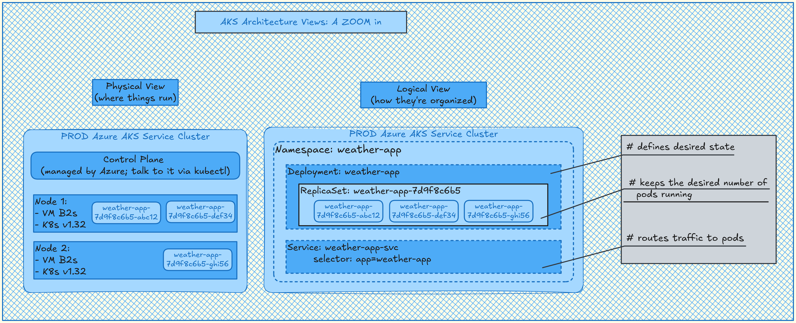

# Weather App on AKS: Multi-Environment Azure Platform with Terraform and GitHub Actions

- **Author:** Mimi Dib 
- **GitHub Link:** [mimidib](https://github.com/mimidib)
- **Date:** 2026-10-26

## Overview

This project deploys **Azure Kubernetes Service (AKS)** clusters and a **managed Redis DB** to support the Remix Weather Application (app provided by Algonquin College). It utilizes **GitHub Actions CI/CD pipelines** to automate the Terraform workflows.

Before completing a complex project with many moving parts, I always like to draw up a diagram to fully grasp the scope and complexity of each connecting piece. I find it helps me be mindful of the purpose of each section while being able to better consider the trade-off's I might need to consider along the way should I run into any blockers that require brainstorming a change of plans.

See the [Excalidraw](Excalidraw.com) architecture diagram I created below, as well as a **Zoom-in** diagram to capture the logical and physical architectures of the Kuberenetes platform.  

*Full Architecture Diagram*  

*K8S Zoom-in Architecture Diagram*

The infrastructure uses a remote Terraform backend, with the state file stored securely in **Azure Blob Storage** so multiple contributors can work on it safely. The Terraform code is organized into reusable modules to manage resources neatly and efficiently while abiding by the DRY Principal (Don't Repeat Yourself).

This project simulates a real-world scenario, with a code reviewer to approve/deny pull requests, and multiple environments to manage, namely: `dev`, `test`, and `prod`.

## GitHub Rulesets and Environment Protection

This section demonstrates how I achieved branch protection rules for the main branch. Using GitHub's **Rulesets** and **Environment protection rules** each requirement listed in the instructions (as well as some optional ones I added) was fulfilled as shown below.

  
*[X] Require pull request reviews before merging (no direct push to `main`)*  
*[X] Limit which branch can deploy to this environment: Limit `main` to deploy to `prod`*  

  
*[X] My Main Protection rulesets apply to the `Default` branch; `main`*

  
*[X] Restrict deletions*

  
*[X] Require at least one approving review before merging (no self-approval)*  
*[X] **optional** Require additional approval for unattributed Copilot pull requests*

  
*[X] Require status checks to pass before merging*
*[X] Require branches to be up to date before merging*

---

## Credits

- **Project brief:** Prof. Robert McKenney, CST8918 – DevOps: Infrastructure as Code, Algonquin College
- **Remix Weather Application:** provided by the course as the sample app to deploy
- **Everything else:** Terraform modules, network design, AKS and Redis configuration, Kubernetes manifests, and GitHub Actions workflows were designed and built by me
